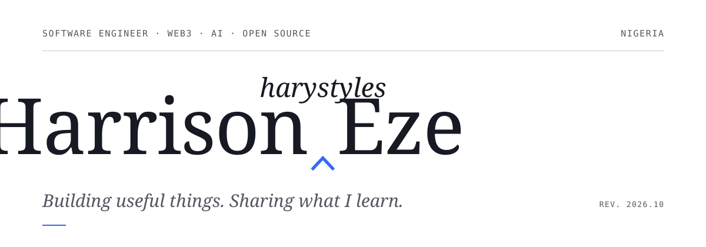

<picture>
  <source media="(prefers-color-scheme: dark)" srcset="./assets/header-dark.svg">
  
</picture>

I'm a software engineer in Nigeria. I build applications, smart contracts and AI agents, mostly where software touches **money, governance or infrastructure**, and I contribute to the open-source projects around them.

Online I'm **Harystyles**, which means Harrison's way of doing things. In practice: make it work, read it back, revise it until it's right. That goes for code and for writing.

<br>

## I build

**[CareGuard](https://github.com/harystyleseze/careguard)**: *an AI agent that manages an elderly parent's healthcare spending, inside limits a caregiver sets.*<br>
It compares medication prices, audits medical bills for errors and pays in USDC on Stellar. A spending-policy engine enforces daily and monthly limits, category budgets and approval thresholds. Built in the open, with CI, tests, architecture decision records and a generated OpenAPI spec.<br>
<sub>`typescript` `stellar` `x402` `next.js` · [Repository](https://github.com/harystyleseze/careguard) · [Live demo](https://careguard-seven.vercel.app)</sub>

> Runs on Stellar **testnet**. The payments are real transactions, but not on mainnet.

**[DCFR](https://github.com/harystyleseze/DCFR)**: *a file repository that answers to its community.*<br>
**Winner, Track 2, HackSecret 5** (Autonomys Auto Drive). Members propose uploads, deletions and shares and vote on them. `FileDAO.sol` executes the proposals that pass, and Auto Drive keeps the files permanent, so no single administrator decides what stays.<br>
<sub>`solidity` `next.js` `ethers.js` `auto drive` · [Repository](https://github.com/harystyleseze/DCFR) · [Live demo](https://dcfr.onrender.com) · [Submission](https://dorahacks.io/buidl/23406)</sub>

**Dispatch**: *from a headline to a routed trade.*<br>
**Winner, LI.FI Agentic Commerce API Vibeathon.** An agent that reads market-relevant news and routes trades across chains through LI.FI.<br>
<sub>`ai agents` `li.fi` · [Announcement](https://x.com/Harystylesdev/status/2031146899118399619)</sub>

> Experimental. A hackathon project, not a trading product: it makes no claim of profitability.

**ChainGuard**: *a Uniswap v4 hook that notices when a pool is being misused.*<br>
My capstone for the Uniswap Hook Incubator (UHI8). It is a security-focused concept for monitoring swap activity and flagging anomalous behaviour inside the hook lifecycle.<br>
<sub>`solidity` `foundry` `uniswap v4` · [Credential](https://opensea.io/item/zora/0xf87F1444b48D75EAe025e64Ab3f4Fc68426B4B37/34)</sub>

<sub>Also on the bench: [storycraft-ai](https://github.com/harystyleseze/storycraft-ai) (story idea → narrated video) · [core-testnet-validator-node-installer](https://github.com/harystyleseze/core-testnet-validator-node-installer) · [AkashChatAgent](https://github.com/harystyleseze/AkashChatAgent)</sub>

<br>

## I contribute

**[Drips](https://www.drips.network/wave/users/5d1bd52f-6511-4b8d-896b-a0e353d5588c)**: contributor and maintainer. API validation and error handling, frontend fixes, regression tests.<br>
**GrantFox**: contributor and maintainer. Issue resolution, debugging, upkeep of developer-facing workflows. [Contributions](https://contribute.grantfox.xyz/public/profile/harystyleseze) · [Maintainer profile](https://maintainer.grantfox.xyz/public/profile/harystyleseze)<br>
**Akash Network**: Akash Insider. Documentation fixes, Akash VPN, developer onboarding, hackathons in Lagos.<br>
**Core DAO**: DevRel and technical ambassador. Meetups, hackathons and workshops for builders.<br>
**NodeBridge Africa**: operated Ethereum validator infrastructure, monitored with Prometheus and Grafana, and taught 300+ students through webinars and events.

<br>

## I write

Technical writing is how I explain how things work. Poetry, essays and long reflections are where I work out what they mean.

I'm gathering the first pieces now. They'll be listed here once they're published, not before.

<br>

## Working set

```text
build     TypeScript · Solidity · Python · Bash · React / Next.js · Node.js
chain     Foundry · Hardhat · ethers.js · Uniswap v4 hooks · EIP-2535 · Stellar
agents    LLM tool-use · x402 · LI.FI · workflow automation
operate   Linux · Docker · Prometheus · Grafana · Git
```

<br>

## Write to me

I'm open to engineering roles, open-source collaboration and well-scoped contract work, especially in Web3 infrastructure, AI agents and developer experience.

[Portfolio](https://harystyles.vercel.app) · [LinkedIn](https://www.linkedin.com/in/harrison-eze-dev/) · [X](https://x.com/harystyleshq) · [Telegram](https://t.me/DevHarystyles) · [Discord](https://discord.com/users/harystyles_98126)

<br>

<picture>
  <source media="(prefers-color-scheme: dark)" srcset="./assets/signature-dark.svg">
  
</picture>

<sub>Last revised October 2026.</sub>
